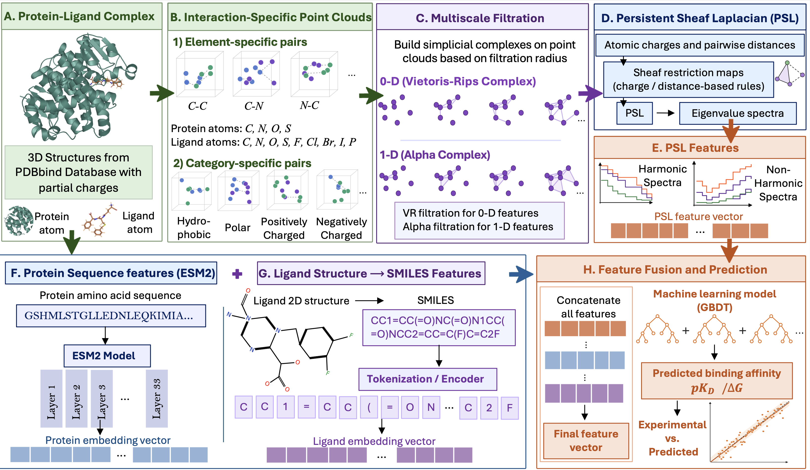

````markdown
# PSL: Persistent Sheaf Laplacian Learning for Protein-Ligand Binding Affinity Prediction



---

PSL is a charge-aware multiscale spectral framework for protein-ligand binding affinity prediction. It integrates atomic coordinates, partial charges, protein atom elements, protein residue categories, and ligand atom elements through persistent sheaf Laplacian representations. The resulting structural descriptors are combined with transformer-based protein sequence embeddings and ligand SMILES embeddings for machine learning prediction of protein-ligand binding affinity.

## Table of Contents

- [Overview](#overview)
- [PSL Representation](#psl-representation)
- [Prerequisites](#prerequisites)
- [Datasets](#datasets)
- [Reproducibility](#reproducibility)
- [Citation](#citation)

---

## Overview

Persistent sheaf Laplacians extend persistent Laplacian theory by incorporating local non-geometric information into multiscale spectral analysis. In protein-ligand systems, each atom is associated with its partial charge, while its Cartesian coordinates define the underlying molecular geometry. PSL combines these quantities through charge-weighted restriction maps and constructs spectral operators over filtration-based molecular complexes.

In this work, protein-ligand complexes are represented through two complementary PSL components. The first component is a zero-dimensional operator constructed from cross-interface protein-ligand edges only. It captures charge-weighted connectivity between protein and ligand atoms. The second component is a one-dimensional operator constructed from alpha-complex edges and triangular faces, encoding local charge-weighted geometric organization of the interaction-specific point cloud.

PSL descriptors are calculated across multiple filtration thresholds for element-specific and category-specific protein-ligand interactions. These structural features are combined with ESM2 protein sequence embeddings and ligand SMILES embeddings to provide a unified molecular representation for binding affinity prediction.

---

## PSL Representation

### Element-Specific PSL Features

The element-specific scheme pairs protein atom elements with ligand atom elements.

| Protein Elements | Ligand Elements |
|------------------|-----------------|
| C, N, O, S | C, N, O, F, P, S, Cl, Br, I |

This produces 36 element-specific protein-ligand interaction groups.

### Category-Specific PSL Features

The category-specific scheme groups protein residues into four physicochemical categories and pairs each category with ligand atom elements.

| Protein Category | Residues |
|------------------|----------|
| Hydrophobic | GLY, ALA, VAL, LEU, ILE, MET, PRO, PHE, TRP |
| Polar | SER, THR, ASN, GLN, TYR, CYS |
| Acidic | ASP, GLU |
| Basic | LYS, ARG, HIS |

This produces 36 category-specific protein-ligand interaction groups.

### Spectral Operators

For each interaction group and filtration threshold, PSL computes the following two spectral operators:

| Operator | Construction | Interactions Included |
|----------|--------------|-----------------------|
| VR0 | Zero-dimensional Rips-type sheaf Laplacian | Protein-ligand edges only |
| Alpha1 | One-dimensional alpha-complex sheaf Laplacian | Protein-protein, ligand-ligand, and protein-ligand edges, together with triangular faces |

The VR0 component describes charge-weighted cross-interface connectivity. The Alpha1 component describes local charge-weighted geometric organization.

For every spectrum, the following nine statistics are calculated from the positive eigenvalues:

```text
sum
minimum
maximum
mean
standard deviation
variance
sum of squares
number of positive eigenvalues
number of zero eigenvalues
```


---

## Prerequisites

The codes were developed and tested on an HPCC environment with Slurm scheduling. The implementation is in Python.

### Core PSL Feature Extraction

```text
python                    3.10 or 3.11
numpy
pandas
gudhi
```

### Protein Sequence Embeddings

```text
torch
fair-esm
```

The supplied protein embedding script uses the ESM2-t33-650M-UR50D model and generates 1280-dimensional protein sequence embeddings.

### Additional Packages

```text
scipy
scikit-learn
matplotlib
seaborn
plotly
ipykernel
nbformat
anywidget
```

### Optional Structure Preparation Software

```text
PDB2PQR
ChimeraX
PDBFixer
OpenMM
RDKit
```

PDB2PQR is used to generate charged protein PQR files. ChimeraX and the additional preprocessing tools are optional and are included for structure preparation and exploratory workflows.

### Installation

```bash
git clone https://github.com/[your-github-username]/[repository-name].git
cd [repository-name]

python -m venv venv_psl
source venv_psl/bin/activate

pip install --upgrade pip
pip install -r requirements.txt
```

To confirm that the input parsers are available, run:

```bash
python -c "from readin import pqr_to_pqre, mol2_to_pqre; print('Input parsers are available.')"
```

---

## Datasets

The processed datasets, labels, protein sequences, ligand SMILES strings, and generated feature files used in this study will be included in this repository.

The PSL pipeline uses protein-ligand complexes from the PDBbind benchmark datasets.

| Dataset | Description |
|---------|-------------|
| PDBbind v2007 | Benchmark dataset used for model development and evaluation |
| PDBbind v2013 | External benchmark dataset |
| PDBbind v2016 | External benchmark dataset |

The expected structural layout is:

```text
data/
├── v2007/
│   ├── 1a0q/
│   │   ├── 1a0q_protein.pdb
│   │   └── 1a0q_ligand.mol2
│   └── ...
├── v2013-refined/
│   ├── 1a0q/
│   │   ├── 1a0q_protein.pdb
│   │   └── 1a0q_ligand.mol2
│   └── ...
└── v2016/
    └── ...
```

Protein PQR files should be stored in a separate directory:

```text
data/
└── pqr/
    ├── 1a0q.pqr
    ├── 1a1e.pqr
    └── ...
```

For each complex, the PSL feature-generation script requires:

```text
Ligand MOL2:
<base_dir>/<PDBID>/<PDBID>_ligand.mol2

Protein PQR:
<protein_pqr_dir>/<PDBID>.pqr
```

Protein PQR files must contain atomic coordinates, atomic partial charges, atom elements, and residue names. Hydrogen atoms are removed automatically during PSL feature generation.

---

## Reproducibility

### I. Protein and Ligand Preparation

Before PSL feature extraction, each complex must contain:

```text
Protein: charged PQR file
Ligand: charged MOL2 file
```

Protein PQR files can be generated using PDB2PQR with the Amber force field. The same charge-generation protocol should be used for all structures in a dataset.

The included ChimeraX and preprocessing scripts contain machine-specific paths. Update these paths before running them on a different system.

---

### II. Generation of PSL Features

The main PSL feature-generation script is:

```text
PSL.py
```

To generate both element-specific and category-specific PSL features for one complex, run:

```bash
python PSL.py \
  --pdbid 1a0q \
  --base_dir data/v2013-refined \
  --protein_pqr_dir data/pqr \
  --protein_pqr_suffix protein \
  --out_dir outputs/psl \
  --schema BOTH \
  --blocks P-L \
  --interface_cutoff 12 \
  --bins "1,2,3,4,5,6,7,8,9,10,11,12" \
  --save_spectra
```

This creates the following output structure:

```text
outputs/
└── psl/
    └── 1a0q/
        ├── 1a0q_features.npy
        └── spectra/
            ├── vr0_ES_P-L_bin1.00.txt
            ├── alpha1_ES_P-L_bin1.00.txt
            ├── vr0_CS_P-L_bin1.00.txt
            ├── alpha1_CS_P-L_bin1.00.txt
            └── ...
```

The file:

```text
<PDBID>_features.npy
```

contains the flattened PSL feature vector for the selected schema and filtration thresholds.

To generate only element-specific features, use:

```bash
--schema ES
```

To generate only category-specific features, use:

```bash
--schema CS
```

The optional `--save_spectra` argument saves individual eigenvalue spectra for inspection and reproducibility.

---

### III. Batch PSL Feature Generation on HPCC

The `run_PSL.sh` script is a Slurm array-job template for PSL feature generation.

Before submission, update the following variables in `run_PSL.sh`:

```bash
PY
BASE_DIR
PROTEIN_PQR_DIR
OUT_DIR
SCHEMA
INTERFACE_CUTOFF
BINS
UNIT
#SBATCH --array
```

Submit the job using:

```bash
sbatch run_PSL.sh
```

The current example processes multiple PDB IDs per array task. The number of structures processed per task is controlled by:

```bash
UNIT=11
```

Adjust the Slurm array range, memory request, runtime, and `UNIT` value according to the number and size of complexes in the selected dataset.

---

### IV. Generation of ESM2 Protein Features

Protein sequence embeddings are generated using the ESM2 protein language model.

The input CSV file must contain:

```text
PDBID,FASTA_Sequence
1a0q,SEQUENCE...
```

The supplied `embed_pdb.py` script uses ESM2-t33-650M-UR50D and mean-pools the residue-level embeddings.

Run the Slurm script using:

```bash
sbatch embed_pdb.sh
```

Before execution, update the dataset-specific paths in `embed_pdb.py`:

```python
csv_path
output_dir
```

Each protein embedding is saved as:

```text
<row_index>_embedding_<PDBID>.npy
```

Each file contains a 1280-dimensional ESM2 feature vector.

---

### V. Generation of Ligand SMILES Features

Ligand SMILES embeddings are generated using the supplied `run_smiles.sh` script.

The input CSV file must contain:

```text
pdbid,SMILES
1a0q,CCO...
```

The script requires the external pretrained molecular-model directory:

```text
PretrainModels/
├── bt_pro/
│   └── generate_bt_fps.py
├── chembl27_pubchem_zinc_512/
│   └── dict.txt
└── checkpoint_best.pt
```

Update the paths in `run_smiles.sh`, then submit:

```bash
sbatch run_smiles.sh
```

Each ligand embedding is saved as:

```text
<PDBID>.npy
```

---

### VI. Final Molecular Representation

For each protein-ligand complex, the final feature vector is formed by concatenating:

```math
\mathbf{z}
=
\left[
\mathbf{z}_{\mathrm{PSL}}^{\mathrm{ES}},
\mathbf{z}_{\mathrm{PSL}}^{\mathrm{CS}},
\mathbf{z}_{\mathrm{protein}},
\mathbf{z}_{\mathrm{ligand}}
\right].
```

where:

```text
z_PSL_ES       Element-specific PSL features
z_PSL_CS       Category-specific PSL features
z_protein      ESM2 protein sequence embedding
z_ligand       Ligand SMILES embedding
```

All feature blocks must be aligned by PDB ID before concatenation. The resulting feature vectors are used for machine learning prediction of protein-ligand binding affinity.

---

## Citation

If you use this code or the PSL representation in your work, please cite:

```text
[Authors]. Persistent Sheaf Laplacian Learning for Protein-Ligand Binding Affinity Prediction.
[Journal], [Year]. [DOI]
```

Please also cite the persistent sheaf Laplacian theory:

```text
X. Wei and G.-W. Wei,
Persistent Sheaf Laplacians,
Foundations of Data Science.
https://doi.org/10.3934/fods.2024033
```

---

## Notes

- Replace all machine-specific absolute paths in the supplied scripts before running the code.
- Store large datasets, pretrained checkpoints, and generated feature matrices using Git LFS, Zenodo, or another data repository when needed.
- The `sheafbind.ipynb` notebook is retained as an exploratory development notebook and is not required for the main `PSL.py` feature-generation workflow.
````
